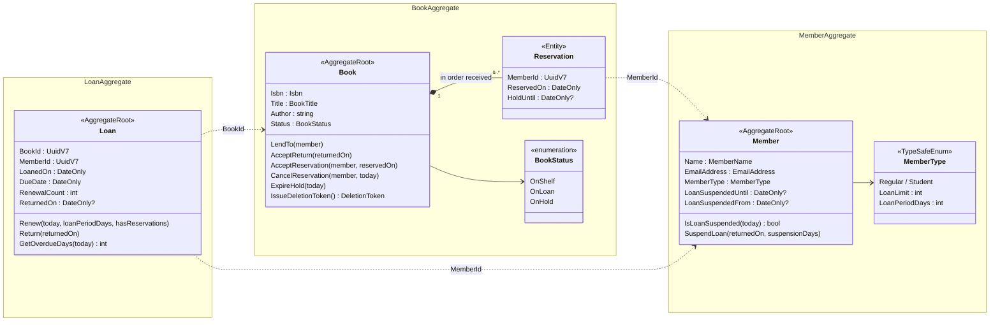

# BasicWebApp

A demo web application (ASP.NET Core Razor Pages) for library lending and reservations that uses the main features of D3Fragments.

## Purpose of this demo

- Give aggregates, value objects, domain rules and domain events business logic beyond simple value assignment, and show "which responsibility goes where" along the types of D3Fragments
- Let you see aggregates with and without child entities, decisions that span aggregates, follow-up processing in the same transaction, and conflict detection for concurrent updates per aggregate, using a library as a self-explanatory subject

## Structure

| Project                    | Architecture layer | Main package references                                                              |
| :------------------------- | :----------------- | :----------------------------------------------------------------------------------- |
| BasicWebApp.Web            | Presentation       | `Sashimi343.D3Fragments.AspNetCore`                                                  |
| BasicWebApp.Application    | Application        | `Sashimi343.D3Fragments.Application`                                                 |
| BasicWebApp.Domain         | Domain             | `Sashimi343.D3Fragments`                                                             |
| BasicWebApp.Infrastructure | Infrastructure     | `Sashimi343.D3Fragments.EFCore`, `Microsoft.EntityFrameworkCore.Sqlite` (in-memory) |

All projects reference `Sashimi343.D3Fragments.Analyzers`.

## How to run

```bash
dotnet run --project demo/01_BasicWebApp/BasicWebApp.Web
```

### Try it from the UI

1. Register a book on "Administrator (librarian)". You can use the ISBN `9784873113364` (or `978-4-87311-336-4` with hyphens).
2. On "Register as a member", register a fictitious name, email address and member type, then enter the registered email address on the sign-in page.
3. Filter by status on "Books" and borrow a book with "Borrow" on its details page. Check the member information, due dates and overdue status on "My page", and return or renew loans there.
4. Sign in as another member to reserve a book on loan. To try several members at the same time, use separate browser profiles. On the book details page you can check the reservation order and your hold expiration date, and cancel the reservation.
5. When the book is returned, it is placed on hold for the first reservation. Advance the business date by 8 days or more on "Administrator (librarian)" and run the hold expiration to move the hold to the next reservation.
6. To try overdue loans, advance the date by 15 days or more (regular members) or 29 days or more (student members) after borrowing, then return the book. Loans are suspended from the day after the return for as many days as the book was overdue.

Members can return and renew only their own loans on "My page". Registering and withdrawing books and expiring holds are on the administrator page. The book list shows 20 books per page.

### Limitations of the demo

- This is a **demo for local use** and must not be run publicly. It deliberately uses a temporary sign-in with only an email address and an administrator page without authentication. Do not use real personal information.
- The temporary sign-in accepts only registered email addresses. Unregistered email addresses are not registered automatically. Authentication uses the standard cookie authentication of ASP.NET Core.
- The database is SQLite in-memory, and an empty schema is created at startup. Data is shared across requests and lost when the application exits. You cannot stay signed in with a cookie from before a restart.
- In the Development environment, you can advance the business date by a positive number of days on the administrator page. This **affects all members** and cannot be reversed. A restart returns to the actual date. Production does not accept date changes. The authentication cookie expiration follows the actual clock.
- Bootstrap, jQuery and jQuery Validation are bundled in `wwwroot`. No additional packages are needed to run the demo.

### Hold expiration API

As the only Web API, `HoldsController` provides `POST /api/holds/expire`. Minimal APIs are not used. On success, it returns the number of processed books, such as `{ "processedCount": 1 }`. You can also run it with the button on the administrator page.

```powershell
Invoke-RestMethod -Method Post `
  -Uri "http://localhost:5079/api/holds/expire" `
  -Headers @{ "X-Requested-By" = "BasicWebApp" }
```

This API does not require member authentication, but requires the `X-Requested-By` header as a CSRF countermeasure. A missing header results in a 400 ProblemDetails response. Changes from Razor Pages use the standard antiforgery token.

### Error display and validation

Form fields are validated with DataAnnotations and the ASP.NET Core ModelState, together with the existing jQuery validation. Business validation is delegated to the existing Commands and the domain. Pages keep the input values and show errors in HTML. The API converts errors to ProblemDetails with the D3Fragments exception handler. Both keep status codes such as 409 for conflicts, 403 for permission violations and 404 for not found.

## Domain model



- Solid arrows are associations within an aggregate, and dashed arrows are references to other aggregates by ID

- 1 book = 1 copy (multiple copies are not handled)
- Aggregates reference each other only by ID

### Member types

| Type    | Loan limit | Loan period |
| :------ | ---------: | ----------: |
| Regular |    5 books |     14 days |
| Student |   10 books |     28 days |

## Functional requirements

| #   | Feature                | Summary                                                                                                                              |
| :-- | :--------------------- | :----------------------------------------------------------------------------------------------------------------------------------- |
| F1  | Member registration    | Registers a member with a name, email address and member type                                                                       |
| F2  | Member inquiry         | Returns the member's information, whether loans are suspended, and the number of books on loan                                      |
| F3  | Book registration      | Registers a book with an ISBN, title and author                                                                                      |
| F4  | Book list              | Lists books with paging (can be filtered by status)                                                                                  |
| F5  | Book inquiry           | Returns the book's information and its reservation queue                                                                            |
| F6  | Book withdrawal        | Deletes a book                                                                                                                       |
| F7  | Loan                   | Lends a book to a member                                                                                                             |
| F8  | Return                 | Returns a book on loan                                                                                                               |
| F9  | Loan renewal           | Extends the due date                                                                                                                 |
| F10 | Reservation            | Reserves a book on loan                                                                                                              |
| F11 | Reservation cancel     | Cancels a reservation                                                                                                                |
| F12 | Hold expiration        | Cancels reservations whose hold has expired and moves the hold to the next reservation (intended as a daily batch; run manually through the API in the demo) |
| F13 | Member's loan list     | Returns the member's books on loan with their due dates and whether they are overdue                                                |

To make rules involving dates easy to try, the current date is taken from `TimeProvider`, and the date can be advanced in the development environment.

## Domain rules

### Member

- M1. The name is 1 to 50 characters, and the email address has a valid format
- M2. The member type determines the loan limit and the loan period
- M3. When an overdue book is returned, loans are suspended from the day after the return date for the same number of days as it was overdue. If loans are already suspended, the later end date is used
- M4. While loans are suspended, the member cannot borrow or reserve books. The suspension ends automatically after its end date (there is no process to lift it; it is decided by date)

### Book

- B1. The ISBN has 13 digits and a valid check digit. The title is 1 to 200 characters
- B2. The status is one of "on shelf", "on loan" or "on hold"
- B3. Only books on loan or on hold can be reserved (a book on the shelf can simply be borrowed)
- B4. The same member cannot reserve the same book twice. The member currently borrowing the book cannot reserve it either
- B5. Reservations are queued in the order received
- B6. On return, if there are reservations, the book is placed "on hold" for the first reservation, with a hold expiration date of the return date + 7 days. If there are no reservations, it goes back "on shelf"
- B7. A book on hold can be borrowed only by the member it is held for. The reservation is fulfilled when the member borrows it
- B8. If the member the book is held for cancels the reservation, or the hold expires, the hold moves to the next reservation (with a hold expiration date of that day + 7 days). If there is no next reservation, the book goes back "on shelf"
- B9. Only books that are on the shelf and not reserved can be withdrawn

### Loan

- L1. The due date is the loan date + the loan period of the member type
- L2. A loan can be renewed only once. It cannot be renewed if it is past the due date or the book is reserved
- L3. The due date after renewal is the renewal date + the loan period of the member type
- L4. If the return date is past the due date, the difference is the number of overdue days
- L5. A returned loan cannot be returned or renewed

### Rules spanning aggregates

- X1. Loan eligibility (F7): a book can be lent only if all of the following are met
  - The member's loans are not suspended (M4)
  - The member has no overdue books
  - The member's number of books on loan is below the limit (M2)
  - The book is on the shelf, or on hold for the member (B7)

## Implementation highlights (mapping to D3Fragments features)

| Feature                              | Where this demo uses it                                                                                                                                        |
| :----------------------------------- | :------------------------------------------------------------------------------------------------------------------------------------------------------------- |
| Aggregate (without child entities)   | Member, Loan                                                                                                                                                   |
| Aggregate (with child entities)      | Book and Reservation                                                                                                                                           |
| Value Object                         | Name, email address, ISBN (with check digit validation), title, etc.                                                                                           |
| TypeSafeEnum                         | Member type (with the loan limit and loan period)                                                                                                              |
| `IDomainRule<TContext>`              | X1 loan eligibility. A decision that spans the member, the book and the loan status, and would be unnatural in any single aggregate                           |
| `DeletionToken<T>`                   | F6 withdrawal. Book itself issues the deletion token only when B9 is met                                                                                       |
| Domain events before commit          | On return (F8), the event raised by Loan updates the hold on Book (B6) and the loan suspension of Member (M3) in the same transaction                         |
| Domain events after commit           | Notifies the member when Book is placed on hold (substituted by a log)                                                                                         |
| Conflict detection per aggregate     | When reservations of the same book (adding child entities) happen at the same time, one of them is returned as a 409 conflict                                 |
| Paging                               | F4 book list                                                                                                                                                   |
| `DomainException`                    | Domain rule violations are thrown as exceptions; the UnitOfWork discards the changes, and they are converted to errors on the page or ProblemDetails HTTP responses in the API |
