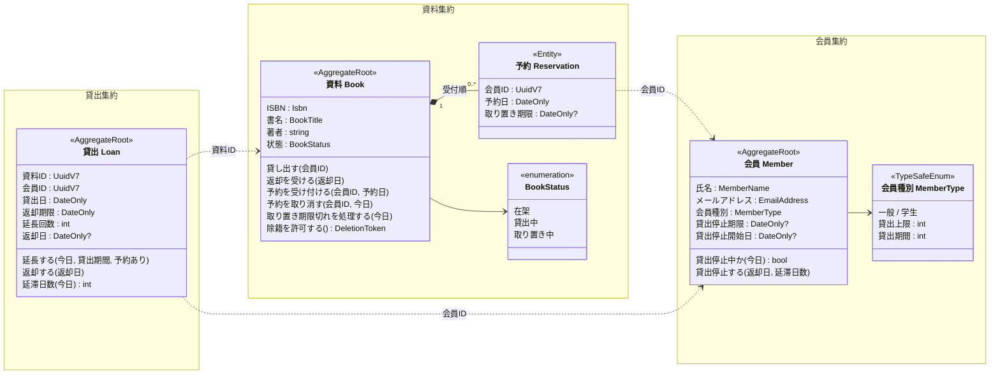

# BasicWebApp

D3Fragments の主要機能を一通り使った、図書館の貸出・予約を扱う Web アプリ（ASP.NET Core Razor Pages）のデモです。

## このデモの意図

- 集約・Value Object・ドメインルール・ドメインイベントに、単純な値の設定以上の業務ロジックを持たせ、「どの責務をどこに置くか」を D3Fragments の型に沿って示す
- 子エンティティを持つ集約／持たない集約、集約をまたぐ判定、同一トランザクション内の後続処理、集約単位の同時更新の競合検知を、図書館という説明不要の題材で確認できるようにする

## 構成

| プロジェクト               | アーキテクチャ層 | 主な参照パッケージ                                                                    |
| :------------------------- | :--------------- | :------------------------------------------------------------------------------------ |
| BasicWebApp.Web            | Presentation     | `Sashimi343.D3Fragments.AspNetCore`                                                   |
| BasicWebApp.Application    | Application      | `Sashimi343.D3Fragments.Application`                                                  |
| BasicWebApp.Domain         | Domain           | `Sashimi343.D3Fragments`                                                              |
| BasicWebApp.Infrastructure | Infrastructure   | `Sashimi343.D3Fragments.EFCore`, `Microsoft.EntityFrameworkCore.Sqlite`（インメモリ） |

全プロジェクトに `Sashimi343.D3Fragments.Analyzers` を参照しています。

## 実行方法

```bash
dotnet run --project demo/01_BasicWebApp/BasicWebApp.Web
```

### 画面から試す

1. 「管理者（司書）」で資料を登録する。ISBN は `9784873113364`（ハイフン付きなら `978-4-87311-336-4`）を利用できる。
2. 「会員登録」で架空の氏名・メールアドレスと会員種別を登録し、ログイン画面で登録済みメールアドレスを入力する。
3. 「資料一覧」で状態を絞り込み、資料詳細の「借りる」から貸し出す。「マイページ」で会員情報・返却期限・延滞状態を確認し、返却・延長する。
4. 別の会員でログインすると、貸出中の資料を予約できる。複数会員を同時に試す場合は別のブラウザプロファイルを使用する。資料詳細で予約順と自分の取り置き期限を確認し、予約を取り消すこともできる。
5. 返却すると先頭の予約者の取り置きになる。「管理者（司書）」で業務日付を8日以上進め、期限切れ処理を実行すると次の予約へ繰り上がる。
6. 延滞を試す場合は貸出後に一般会員なら15日以上、学生会員なら29日以上進めて返却する。返却翌日から延滞日数分だけ貸出停止となる。

会員はマイページで本人の貸出だけを返却・延長できる。資料登録・除籍・期限切れ処理は管理者ページにまとめている。資料一覧は1ページ20件。

### デモの制約

- **ローカルで試すためのデモ**であり、公開運用しないこと。メールアドレスだけの暫定ログインと、認証のない管理者ページを意図的に採用している。実在する個人情報は使用しないこと。
- 暫定ログインは登録済みメールアドレスのみを受け付ける。未登録メールの自動登録はしない。認証は ASP.NET Core 標準の Cookie 認証を使用する。
- DB は SQLite インメモリで、起動時に空のスキーマを作成する。データは複数リクエスト間で共有され、アプリの終了時に消える。再起動前のCookieでログインを続けることはできない。
- Development 環境では管理者ページから業務日付を正の日数だけ進められる。**全会員に影響**し、逆行はできない。再起動で実際の日付へ戻る。Production では日付操作を受け付けない。認証Cookieの期限は実際の時計に従う。
- Bootstrap・jQuery・jQuery Validation は `wwwroot` 内の同梱ファイルを使用する。実行用のパッケージ追加は不要。

### 取り置き期限切れ処理API

唯一のWeb APIとして、`HoldsController` の `POST /api/holds/expire` を提供する。Minimal APIは使用しない。正常時は `{ "processedCount": 1 }` のように処理した資料の件数を返す。管理者画面のボタンからも実行できる。

```powershell
Invoke-RestMethod -Method Post `
  -Uri "http://localhost:5079/api/holds/expire" `
  -Headers @{ "X-Requested-By" = "BasicWebApp" }
```

このAPIに会員認証は不要だが、CSRF対策として `X-Requested-By` ヘッダを必須とする。ヘッダ欠落は400のProblemDetails応答になる。Razor Pages の変更操作には標準の偽造防止トークンを使用する。

### エラーの表示と検証

画面項目はDataAnnotationsとASP.NET CoreのModelStateで検証し、既存のjQuery検証も併用する。業務上の検証は既存Command・ドメインへ委ねる。画面では入力値を保持し、日本語のエラーをHTMLで表示する。APIはD3Fragmentsの例外ハンドラでProblemDetailsへ変換する。いずれも競合409・権限違反403・未検出404等のステータスを維持する。

## ドメインモデル



- 実線の矢印は集約内の関連、破線の矢印は ID による他集約への参照を表す

- 1 資料 = 1 冊とする（複本は扱わない）
- 集約間の参照は ID のみ

### 会員種別

| 種別 | 貸出上限 | 貸出期間 |
| :--- | -------: | -------: |
| 一般 |     5 冊 |    14 日 |
| 学生 |    10 冊 |    28 日 |

## 機能要件

| #   | 機能                 | 概要                                                                                                  |
| :-- | :------------------- | :---------------------------------------------------------------------------------------------------- |
| F1  | 会員登録             | 氏名・メールアドレス・会員種別を指定して登録する                                                      |
| F2  | 会員照会             | 会員の情報と、貸出停止中かどうか・貸出中の冊数を返す                                                  |
| F3  | 資料登録             | ISBN・書名・著者を指定して登録する                                                                    |
| F4  | 資料一覧             | 資料をページングして一覧取得する（状態で絞り込み可）                                                  |
| F5  | 資料照会             | 資料の情報と予約の待ち行列を返す                                                                      |
| F6  | 資料の除籍           | 資料を削除する                                                                                        |
| F7  | 貸出                 | 会員に資料を貸し出す                                                                                  |
| F8  | 返却                 | 貸出中の資料を返却する                                                                                |
| F9  | 貸出延長             | 返却期限を延長する                                                                                    |
| F10 | 予約                 | 貸出中の資料を予約する                                                                                |
| F11 | 予約取消             | 予約を取り消す                                                                                        |
| F12 | 取り置き期限切れ処理 | 取り置き期限を過ぎた予約を取り消し、次の予約者へ繰り上げる（日次バッチ想定。デモでは API で手動実行） |
| F13 | 会員の貸出一覧       | 会員の貸出中の資料を返却期限・延滞の有無とともに返す                                                  |

日付が絡むルールを試せるよう、現在日付は `TimeProvider` から取得し、開発環境では日付を進められるようにする。

## ドメインルール

### 会員 Member

- M1. 氏名は 1〜50 文字、メールアドレスは形式が正しいこと
- M2. 会員種別ごとに貸出上限冊数と貸出期間が決まる
- M3. 延滞して返却した場合、返却日の翌日から延滞日数と同じ日数だけ貸出停止になる。すでに停止中なら、停止期限は遅い方を採用する
- M4. 貸出停止中は貸出・予約ができない。停止期限を過ぎれば自動的に解除される（解除処理は持たず、日付で判定する）

### 資料 Book

- B1. ISBN は 13 桁で、チェックディジットが正しいこと。書名は 1〜200 文字
- B2. 状態は「在架」「貸出中」「取り置き中」のいずれか
- B3. 予約できるのは貸出中または取り置き中の資料のみ（在架ならそのまま借りればよい）
- B4. 同じ会員が同じ資料を重複して予約できない。その資料を現在借りている会員も予約できない
- B5. 予約は受付順に並ぶ
- B6. 返却時、予約があれば先頭の予約者向けの「取り置き中」にし、取り置き期限を返却日 + 7 日とする。予約がなければ「在架」に戻す
- B7. 取り置き中の資料は、取り置き対象の会員だけが借りられる。借りた時点でその予約は消化される
- B8. 取り置き対象の会員が予約を取り消した場合、または取り置き期限を過ぎた場合は、次の予約者へ繰り上げる（取り置き期限は繰り上げ日 + 7 日）。次の予約者がいなければ「在架」に戻す
- B9. 除籍できるのは、在架かつ予約がない資料のみ

### 貸出 Loan

- L1. 返却期限は、貸出日 + 会員種別の貸出期間
- L2. 延長は 1 回まで。返却期限を過ぎている場合と、その資料に予約がある場合は延長できない
- L3. 延長後の返却期限は、延長した日 + 会員種別の貸出期間
- L4. 返却日が返却期限を過ぎていれば、その差を延滞日数とする
- L5. 返却済みの貸出は返却・延長できない

### 集約をまたぐルール

- X1. 貸出可否（F7）: 以下をすべて満たす場合のみ貸し出せる
  - 会員が貸出停止中でない（M4）
  - 会員が延滞中の資料を持っていない
  - 会員の貸出中冊数が上限未満（M2）
  - 資料が在架、または自分向けの取り置き中（B7）

## 実装上のポイント（D3Fragments の機能との対応）

| 機能                        | このデモでの使いどころ                                                                                                           |
| :-------------------------- | :------------------------------------------------------------------------------------------------------------------------------- |
| 集約（子エンティティなし）  | Member, Loan                                                                                                                     |
| 集約（子エンティティあり）  | Book と Reservation                                                                                                              |
| Value Object                | 氏名、メールアドレス、ISBN（チェックディジット検証）、書名など                                                                   |
| TypeSafeEnum                | 会員種別（貸出上限・貸出期間を持たせる）                                                                                         |
| `IDomainRule<TContext>`     | X1 貸出可否。会員・資料・貸出状況にまたがり、特定の集約に置くのが不自然な判定                                                    |
| `DeletionToken<T>`          | F6 除籍。B9 を満たす場合のみ、Book 自身が削除トークンを発行する                                                                  |
| Commit 前のドメインイベント | 返却（F8）で Loan が発行したイベントを受けて、同じトランザクション内で Book の取り置き（B6）と Member の貸出停止（M3）を更新する |
| Commit 後のドメインイベント | Book が取り置き中になったときに、予約者へ通知する（ログ出力で代用）                                                              |
| 集約単位の競合検知          | 同じ資料への予約（子エンティティの追加）が同時に行われた場合、一方を競合として 409 で返す                                        |
| ページング                  | F4 資料一覧                                                                                                                      |
| `DomainException`           | ドメインルール違反は例外として送出し、UnitOfWork で変更を破棄した上で、画面では日本語エラー、APIではProblemDetailsのHTTPレスポンスに変換する |
