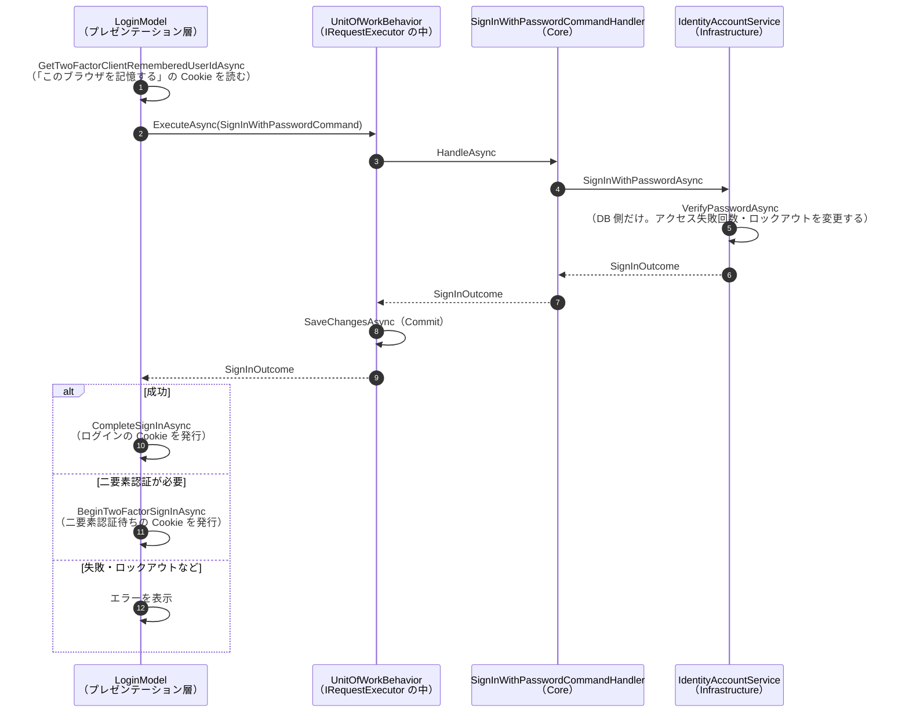
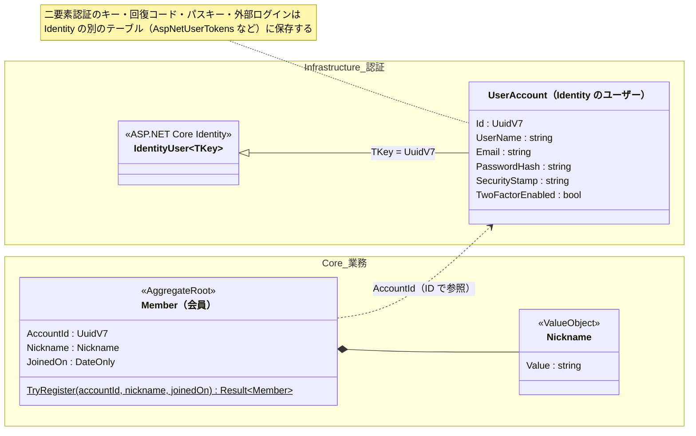

# IdentityIntegration

ASP.NET Core Identity のユーザー登録・ログイン・二要素認証・パスキー・外部ログインを、D3Fragments のアーキテクチャに沿って実装した Web アプリ（ASP.NET Core Razor Pages）のデモです。

## このデモの意図

- `SignInManager` の「DB への書き込み」と「Cookie の発行」を分け、DB 側を Command（Unit of Work）で、Cookie 側を Commit 後のプレゼンテーション層で行う実装例を示す（[DFR0017](https://sashimi343.github.io/D3Fragments/ja/analyzers/DFR0017.html)）
- 保存を Unit of Work に任せる Identity のストア（`AddD3FragmentsStores`）と、`IdentityDbContext` 系のコンテキストに D3Fragments の規約を適用する方法（`ApplyD3FragmentsConventions`）を示す
- Identity のユーザー（認証）と、業務上の利用者である会員（ドメインの集約）を分け、ID で紐づける実装例を示す
- 認証以外の機能は最小限にする（マイページは会員のニックネームなどの表示だけ）

## 構成

| プロジェクト                       | アーキテクチャ層         | 主な参照パッケージ                                                                                       |
| :--------------------------------- | :----------------------- | :------------------------------------------------------------------------------------------------------- |
| IdentityIntegration.AppHost        | （なし）                 | `Aspire.Hosting.AppHost`, `Aspire.Hosting.Keycloak`, `CommunityToolkit.Aspire.Hosting.MailPit`           |
| IdentityIntegration.Web            | Presentation             | `Sashimi343.D3Fragments.AspNetCore`, `Microsoft.AspNetCore.Authentication.OpenIdConnect`                 |
| IdentityIntegration.Core           | Application + Domain     | `Sashimi343.D3Fragments.Application`                                                                     |
| IdentityIntegration.Infrastructure | Infrastructure           | `Sashimi343.D3Fragments.EFCore`, `Sashimi343.D3Fragments.Identity.EFCore`, `Microsoft.EntityFrameworkCore.Sqlite`（インメモリ） |

AppHost を除く全プロジェクトが `Sashimi343.D3Fragments.Analyzers` を参照しています。Core はアプリケーション層とドメイン層を兼ねるプロジェクトで、会員（`Member`）と認証の Command を持ちます。

AppHost（Aspire）は次のリソースを起動します。

| リソース   | 内容                                                                                        |
| :--------- | :------------------------------------------------------------------------------------------ |
| `web`      | このアプリ（`https://localhost:7180`）                                                      |
| `mailpit`  | メールの送信先（SMTP サーバー）。送ったメールは Mailpit の Web 画面で確認する               |
| `keycloak` | 外部ログインの OIDC プロバイダー（`https://localhost:8080`）。`Realms` フォルダーの realm を取り込む |

## 実行方法

.NET 10 SDK と Docker（Mailpit・Keycloak のコンテナ用）が必要です。

Identity 連携のパッケージは未公開のため、リポジトリのルートでパッケージを作ってから起動します。作ったパッケージは `artifacts` フォルダーに出力され、デモの `nuget.config` がこのフォルダーを参照します。パッケージを公開したら、`nuget.config` を削除し、`Directory.Packages.props` のバージョンを公開版に変更します。

```bash
dotnet pack D3Fragments.slnx -c Release -o artifacts -p:Version=0.2.0-local.2
```

```bash
dotnet run --project demo/02_IdentityIntegration/IdentityIntegration.AppHost
```

- AppHost の `dotnet run` は Aspire CLI を通して起動する。Aspire CLI をインストールしていなければ、.NET SDK の `dnx` で Aspire CLI のパッケージを取得して使う。初回はパッケージをダウンロードするため、ネットワーク接続が必要
- Aspire CLI をインストールしている場合は、`demo/02_IdentityIntegration` で `aspire run` としてもよい
- ソリューション（`IdentityIntegration.slnx`）は `dotnet run` で実行できないため、AppHost のプロジェクトを指定する

Aspire のダッシュボードから `web`（`https://localhost:7180`）と `mailpit` の Web 画面を開きます。

### 画面から試す

1. 「ユーザー登録」でユーザー名・ニックネーム・メールアドレス・パスワードを登録する。ユーザー名はログインに、ニックネームは会員の表示名に使う。パスワードは6文字以上で、英大文字・英小文字・数字・記号をそれぞれ1文字以上含める（例：`Demo#Pass1`）。
2. Mailpit に届いた確認メールのリンクを開く。確認が済むまでログインできない。
3. 「ログイン」でユーザー名とパスワードを入力する。マイページに「今回のサインインの方法」（`pwd`・`mfa`・外部ログインのプロバイダー）が表示される。
4. マイページの「二要素認証の設定」で、認証アプリ（QR コード）を設定するか、メールの確認コードで二要素認証を有効にする。表示された回復コードを控える。
5. ログアウトして再度ログインすると、二要素認証の画面になる。認証アプリかメールの確認コード、または回復コードでログインする。「このブラウザを記憶する」を選ぶと、次回からパスワードだけでログインできる。
6. マイページの「パスキーの管理」でパスキーを登録すると、ログイン画面の「パスキーでログイン」でパスワードなしでログインできる。
7. ログイン画面の「Keycloak でログイン」で、Keycloak のデモ用ユーザー（ユーザー名 `keycloak-user`、パスワード `Keycloak#Demo1`）でログインする。初回はこのサイトのユーザー名とニックネームを決めてアカウントを作る画面になる。

パスワードや確認コードを5回続けて間違えると、アカウントが5分間ロックされる。

## 認証の方式

### 使える方式

| 方式                   | 段階          | 使える条件                             | Identity の部品                          | 備考                                                                                  |
| :--------------------- | :------------ | :------------------------------------- | :--------------------------------------- | :------------------------------------------------------------------------------------ |
| パスワード             | 1段目         | メールアドレスを確認済み               | `UserManager.CheckPasswordAsync`         | 失敗はロックアウトの回数に数える                                                      |
| 外部ログイン（Keycloak） | 1段目       | 初回はアカウントを作る                 | OpenID Connect, `UserManager.AddLoginAsync` | メールアドレスは ID プロバイダーが確認済みとして扱う                                |
| パスキー               | 1段目（単独） | パスキーを登録済み                     | `SignInManager.PerformPasskeyAssertionAsync` | それ自体が多要素（所持と生体認証・PIN）のため、二要素認証を求めない（Identity と同じ） |
| 認証アプリ（TOTP）     | 2段目         | 認証アプリを設定済み                   | `AuthenticatorTokenProvider`             | QR コードは qrcode.js で表示する                                                      |
| メールの確認コード     | 2段目         | 二要素認証が有効（メールは確認済み）   | `EmailTokenProvider`                     | 送信回数は制限していない（下記の制約を参照）                                          |
| 回復コード             | 2段目         | 二要素認証を有効にしたときに10個作る   | `RedeemTwoFactorRecoveryCodeAsync`       | 1回ずつ使える。ロックアウトは確認しない（Identity と同じ）                            |

- 二要素認証を有効にすると、2段目は認証アプリ（設定済みの場合）とメールの確認コードから選べる。どちらで有効にしても、もう一方も使える（Identity の `GetValidTwoFactorProvidersAsync` に従う）
- 「このブラウザを記憶する」を選ぶと、そのブラウザでは2段目を省略する。マイページで解除できる。security stamp が変わる操作（二要素認証の有効化・無効化など）をすると、ブラウザの記憶も無効になる
- 外部ログインでも、二要素認証を有効にしたアカウントには2段目を求める

### DB と Cookie の分け方

`SignInManager` のサインインのメソッド（`PasswordSignInAsync` など）は、DB への書き込み（アクセス失敗回数・ロックアウト・回復コードの消費・パスキーの署名回数）と Cookie の発行を1回で行います。このデモでは、次のように分けています。図はパスワードでのログインの例です。



- 失敗は例外ではなく `SignInOutcome` で返す（Command が例外で終わると、Unit of Work がアクセス失敗回数の記録まで破棄するため）
- 確認メールは登録の Command の Commit 後に別の Command で送る（登録が保存されなかったのにメールだけ届くことがないように）
- パスキーの署名とオリジンの検証（`PerformPasskeyAssertionAsync`・`PerformPasskeyAttestationAsync`）は DB を変更しないため、プレゼンテーション層で行い、結果を Command に渡して保存する
- 自分の security stamp が変わる操作（二要素認証の有効化・無効化、認証アプリのキーの作成）の後は、`RefreshSignInAsync` で自分の Cookie を作り直す
- `UserManager` を画面で使うのは読み取り（Cookie の発行に使うユーザーの取得、設定状況の表示）だけにしている

## Identity のユーザーと会員



- 実線の三角の矢印は継承、ひし形は集約の中の値オブジェクト、破線の矢印は ID による参照を表す

- `UserAccount`（Identity のユーザー）は、認証のための永続化モデルとして Infrastructure 層に置く。項目は Identity が保存のために使うもの（パスワードのハッシュ・security stamp など）で、業務のルールは持たない
- 業務上の利用者はドメインの集約 `Member`（会員）で表す。Identity の型には依存せず、`AccountId` で `UserAccount` を参照する
- ユーザー登録・外部ログインでの初回登録では、`UserAccount` と `Member` を1つの Command で作り、同じ Unit of Work で保存する。会員登録のドメインイベント（`MemberRegisteredDomainEvent`）は Commit 後に1回だけ処理される（ログに「会員を登録しました」と出る）。`UserManager` の操作ごとに `SaveChanges` が呼ばれることはない
- `UnitOfWorkBehavior` は Command が失敗の `Result` を返しても保存するため、Identity のユーザーを作る前に会員の入力（ニックネーム）を検証する。ユーザーを作った後の失敗は例外にして、変更を破棄させる
- マイページは Cookie のユーザー ID から `GetMemberProfileQuery` で会員を取得して表示する
- プレゼンテーション層は `SignInManager<UserAccount>` で Cookie を発行するため `UserAccount` を参照する。[DFR0002](https://sashimi343.github.io/D3Fragments/ja/analyzers/DFR0002.html) は Identity のユーザー型（`Infrastructure_IdentityUser`）への参照を例外として許可する
- `UserAccount` のキーは `UuidV7` で、D3Fragments の規約で Guid の列に変換する。`UserAccount` と `Member` は1つの DbContext（`IdentityUserContext` を継承）に持つ

## デモの制約

- **ローカルで試すためのデモ**であり、公開運用しないこと。実在する個人情報やパスワードは使用しないこと。
- DB は SQLite インメモリで、起動時に空のスキーマを作成する。データはアプリの終了（`web` の再起動を含む）で消える。再起動前の Cookie は使えなくなる。
- security stamp を毎回確認する（`SecurityStampValidatorOptions.ValidationInterval = 0`）。確認のたびに Cookie のクレームが作り直されるため、`OnRefreshingPrincipal` でサインインの方法（`amr`）を引き継いでいる。
- メールの確認コードの送信回数・ログインの試行回数（ロックアウト以外）は制限していない。公開するアプリでは、ASP.NET Core のレート制限などでアプリが制限すること。
- ロックアウトの解除とトークンの有効期限は `TimeProvider` に従わない（Identity の仕様）。
- パスキーを削除しても security stamp は変わらないため、そのパスキーでログインした他のセッションは切れない（Identity と同じ）。
- 確認メールの再送・パスワードのリセット・メールアドレスの変更は実装していない。
- ログアウトはこのアプリの Cookie を消すだけで、Keycloak からはログアウトしない（次の「Keycloak でログイン」はパスワードの入力なしで通る）。
- qrcode.js は CDN（cdnjs）から読み込む。Bootstrap・jQuery は `wwwroot` 内の同梱ファイルを使用する。
