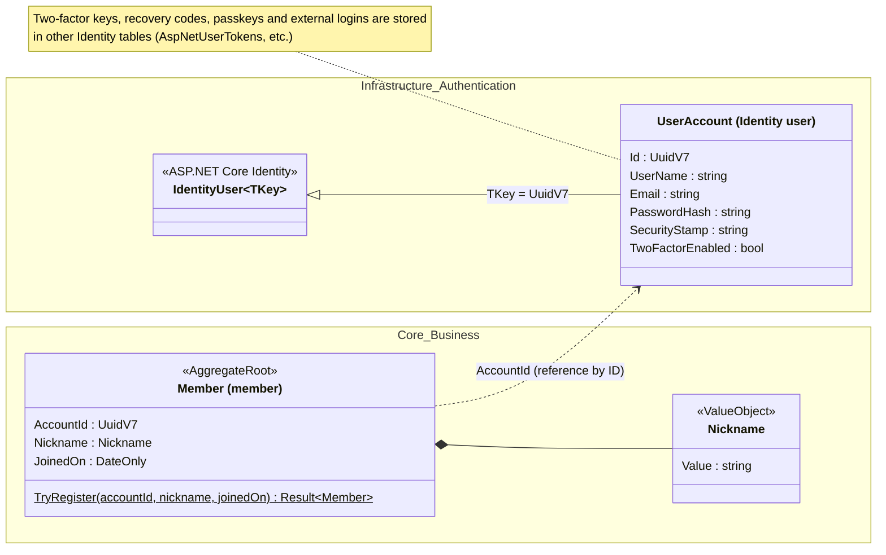

# IdentityIntegration

A demo web application (ASP.NET Core Razor Pages) that implements registration, sign-in, two-factor authentication, passkeys and external login with ASP.NET Core Identity, following the D3Fragments architecture.

## Purpose of this demo

- Show an implementation that separates "writing to the database" from "issuing cookies" in `SignInManager`, doing the database side in a Command (Unit of Work) and the cookie side in the presentation layer after the commit ([DFR0017](https://sashimi343.github.io/D3Fragments/en/analyzers/DFR0017.html))
- Show the Identity stores that leave saving to the Unit of Work (`AddD3FragmentsStores`), and how to apply the D3Fragments conventions to an `IdentityDbContext`-family context (`ApplyD3FragmentsConventions`)
- Show an implementation that separates the Identity user (authentication) from the member, the business user (a domain aggregate), and links them by ID
- Keep features other than authentication to a minimum (My page only shows the member's nickname and similar information)

## Structure

| Project                            | Architecture layer   | Main package references                                                                                                          |
| :--------------------------------- | :------------------- | :------------------------------------------------------------------------------------------------------------------------------- |
| IdentityIntegration.AppHost        | (none)               | `Aspire.Hosting.AppHost`, `Aspire.Hosting.Keycloak`, `CommunityToolkit.Aspire.Hosting.MailPit`                                   |
| IdentityIntegration.Web            | Presentation         | `Sashimi343.D3Fragments.AspNetCore`, `Microsoft.AspNetCore.Authentication.OpenIdConnect`                                         |
| IdentityIntegration.Core           | Application + Domain | `Sashimi343.D3Fragments.Application`                                                                                             |
| IdentityIntegration.Infrastructure | Infrastructure       | `Sashimi343.D3Fragments.EFCore`, `Sashimi343.D3Fragments.Identity.EFCore`, `Microsoft.EntityFrameworkCore.Sqlite` (in-memory) |

All projects except AppHost reference `Sashimi343.D3Fragments.Analyzers`. Core is a project that serves as both the application layer and the domain layer, and holds the member (`Member`) and the authentication Commands.

AppHost (Aspire) starts the following resources.

| Resource   | Description                                                                                                  |
| :--------- | :----------------------------------------------------------------------------------------------------------- |
| `web`      | This application (`https://localhost:7180`)                                                                  |
| `mailpit`  | Destination of emails (SMTP server). Sent emails can be checked in the Mailpit web UI                        |
| `keycloak` | OIDC provider for external login (`https://localhost:8080`). Imports the realm in the `Realms` folder        |

## How to run

The .NET 10 SDK and Docker (for the Mailpit and Keycloak containers) are required.

```bash
dotnet run --project demo/02_IdentityIntegration/IdentityIntegration.AppHost
```

- `dotnet run` of AppHost starts through the Aspire CLI. If the Aspire CLI is not installed, the Aspire CLI package is fetched and used with `dnx` of the .NET SDK. The first run downloads the package, so a network connection is required
- If the Aspire CLI is installed, you can also run `aspire run` in `demo/02_IdentityIntegration`
- The solution (`IdentityIntegration.slnx`) cannot be run with `dotnet run`, so specify the AppHost project

Open `web` (`https://localhost:7180`) and the `mailpit` web UI from the Aspire dashboard.

### Try it from the UI

1. On "Register", register a user name, nickname, email address and password. The user name is used to sign in, and the nickname is the member's display name. The password must be at least 6 characters and include at least one uppercase letter, lowercase letter, digit and symbol (e.g. `Demo#Pass1`).
2. Open the link in the confirmation email that arrives in Mailpit. You cannot sign in until the email address is confirmed.
3. On "Sign in", enter the user name and password. My page shows "Sign-in methods this time" (`pwd`, `mfa`, and the external login provider).
4. On "Two-factor authentication settings" on My page, set up an authenticator app (QR code) or enable two-factor authentication with email verification codes. Write down the recovery codes shown.
5. Sign out and sign in again to get the two-factor authentication page. Sign in with the authenticator app, an email verification code, or a recovery code. If you select "Remember this browser", you can sign in with just a password next time.
6. Register a passkey on "Manage passkeys" on My page to sign in without a password with "Sign in with a passkey" on the sign-in page.
7. With "Sign in with Keycloak" on the sign-in page, sign in as the Keycloak demo user (user name `keycloak-user`, password `Keycloak#Demo1`). On the first sign-in, a page appears to create an account by choosing a user name and nickname for this site.

After 5 consecutive wrong passwords or verification codes, the account is locked for 5 minutes.

## Authentication methods

### Available methods

| Method                     | Step             | Condition                                                     | Identity components                          | Notes                                                                                                                      |
| :------------------------- | :--------------- | :------------------------------------------------------------ | :------------------------------------------- | :------------------------------------------------------------------------------------------------------------------------- |
| Password                   | First            | The email address is confirmed                                | `UserManager.CheckPasswordAsync`             | Failures count toward lockout                                                                                              |
| External login (Keycloak)  | First            | An account is created on the first sign-in                    | OpenID Connect, `UserManager.AddLoginAsync`  | The email address is treated as already confirmed by the identity provider                                                 |
| Passkey                    | First (alone)    | A passkey is registered                                       | `SignInManager.PerformPasskeyAssertionAsync` | Multi-factor by itself (possession plus biometrics or PIN), so two-factor authentication is not required (same as Identity) |
| Authenticator app (TOTP)   | Second           | The authenticator app is set up                               | `AuthenticatorTokenProvider`                 | The QR code is shown with qrcode.js                                                                                        |
| Email verification code    | Second           | Two-factor authentication is enabled (email is confirmed)     | `EmailTokenProvider`                         | The number of sends is not limited (see the limitations below)                                                             |
| Recovery code              | Second           | 10 codes are created when two-factor authentication is enabled | `RedeemTwoFactorRecoveryCodeAsync`          | Each can be used once. Lockout is not checked (same as Identity)                                                           |

- When two-factor authentication is enabled, the second step can be chosen from the authenticator app (if set up) and email verification codes. Whichever was used to enable it, the other can also be used (following Identity's `GetValidTwoFactorProvidersAsync`)
- If you select "Remember this browser", the second step is skipped in that browser. You can undo this on My page. Operations that change the security stamp (enabling or disabling two-factor authentication, etc.) also invalidate the remembered browser
- Even with external login, accounts with two-factor authentication enabled require the second step

### Separating the database and cookies

The sign-in methods of `SignInManager` (such as `PasswordSignInAsync`) write to the database (access failure count, lockout, recovery code redemption, passkey signature count) and issue the cookie in a single call. This demo separates them as follows. The diagram shows sign-in with a password.

```mermaid
sequenceDiagram
    autonumber
    participant Page as LoginModel<br/>(presentation layer)
    participant UoW as UnitOfWorkBehavior<br/>(inside IRequestExecutor)
    participant Handler as SignInWithPasswordCommandHandler<br/>(Core)
    participant Service as IdentityAccountService<br/>(Infrastructure)

    Page->>Page: GetTwoFactorClientRememberedUserIdAsync<br/>(reads the "remember this browser" cookie)
    Page->>UoW: ExecuteAsync(SignInWithPasswordCommand)
    UoW->>Handler: HandleAsync
    Handler->>Service: SignInWithPasswordAsync
    Service->>Service: VerifyPasswordAsync<br/>(database side only; changes the access failure count and lockout)
    Service-->>Handler: SignInOutcome
    Handler-->>UoW: SignInOutcome
    UoW->>UoW: SaveChangesAsync (commit)
    UoW-->>Page: SignInOutcome
    alt Succeeded
        Page->>Page: CompleteSignInAsync<br/>(issues the sign-in cookie)
    else Two-factor authentication required
        Page->>Page: BeginTwoFactorSignInAsync<br/>(issues the cookie for pending two-factor authentication)
    else Failed, locked out, etc.
        Page->>Page: Shows the error
    end
```

- Failures are returned as `SignInOutcome`, not as exceptions (if a Command ends with an exception, the Unit of Work also discards the recorded access failure count)
- The confirmation email is sent by a separate Command after the registration Command is committed (so that an email never arrives for a registration that was not saved)
- Verifying the passkey signature and origin (`PerformPasskeyAssertionAsync`, `PerformPasskeyAttestationAsync`) does not change the database, so it is done in the presentation layer and the result is passed to a Command to be saved
- After operations that change your own security stamp (enabling or disabling two-factor authentication, creating the authenticator app key), `RefreshSignInAsync` rebuilds your own cookie
- Pages use `UserManager` only for reading (getting the user to issue cookies for, showing the current settings)

## Identity user and member



- The solid arrow with a triangle is inheritance, the diamond is a value object within the aggregate, and the dashed arrow is a reference by ID

- `UserAccount` (the Identity user) is placed in the Infrastructure layer as a persistence model for authentication. Its fields are those Identity uses for storage (password hash, security stamp, etc.), and it has no business rules
- The business user is represented by the domain aggregate `Member`. It does not depend on Identity types and refers to `UserAccount` by `AccountId`
- On registration and on the first external login, `UserAccount` and `Member` are created in one Command and saved in the same Unit of Work. The member registration domain event (`MemberRegisteredDomainEvent`) is handled only once after the commit (the log shows "The member has been registered"). `SaveChanges` is not called for each `UserManager` operation
- `UnitOfWorkBehavior` saves changes even when the Command returns a failed `Result`, so the member input (nickname) is validated before the Identity user is created. Failures after the user is created are thrown as exceptions to discard the changes
- My page gets the member with `GetMemberProfileQuery` from the user ID in the cookie and shows it
- The presentation layer references `UserAccount` to issue cookies with `SignInManager<UserAccount>`. [DFR0002](https://sashimi343.github.io/D3Fragments/en/analyzers/DFR0002.html) allows references to the Identity user type (`Infrastructure_IdentityUser`) as an exception
- The key of `UserAccount` is `UuidV7`, converted to a Guid column by the D3Fragments conventions. `UserAccount` and `Member` are held in one DbContext (inheriting `IdentityUserContext`)

## Limitations of the demo

- This is a **demo for local use** and must not be run publicly. Do not use real personal information or passwords.
- The database is SQLite in-memory, and an empty schema is created at startup. Data is lost when the application exits (including restarts of `web`). Cookies from before a restart can no longer be used.
- The security stamp is checked every time (`SecurityStampValidatorOptions.ValidationInterval = 0`). The cookie claims are rebuilt at every check, so `OnRefreshingPrincipal` carries over the sign-in methods (`amr`).
- The number of email verification code sends and sign-in attempts (other than lockout) is not limited. Public apps should limit them themselves, e.g. with ASP.NET Core rate limiting.
- Lockout release and token expiration do not follow `TimeProvider` (Identity behavior).
- Deleting a passkey does not change the security stamp, so other sessions signed in with that passkey are not ended (same as Identity).
- Resending the confirmation email, password reset and email address change are not implemented.
- Signing out only deletes this application's cookies and does not sign out of Keycloak (the next "Sign in with Keycloak" goes through without entering a password).
- qrcode.js is loaded from a CDN (cdnjs). Bootstrap and jQuery are bundled in `wwwroot`.
