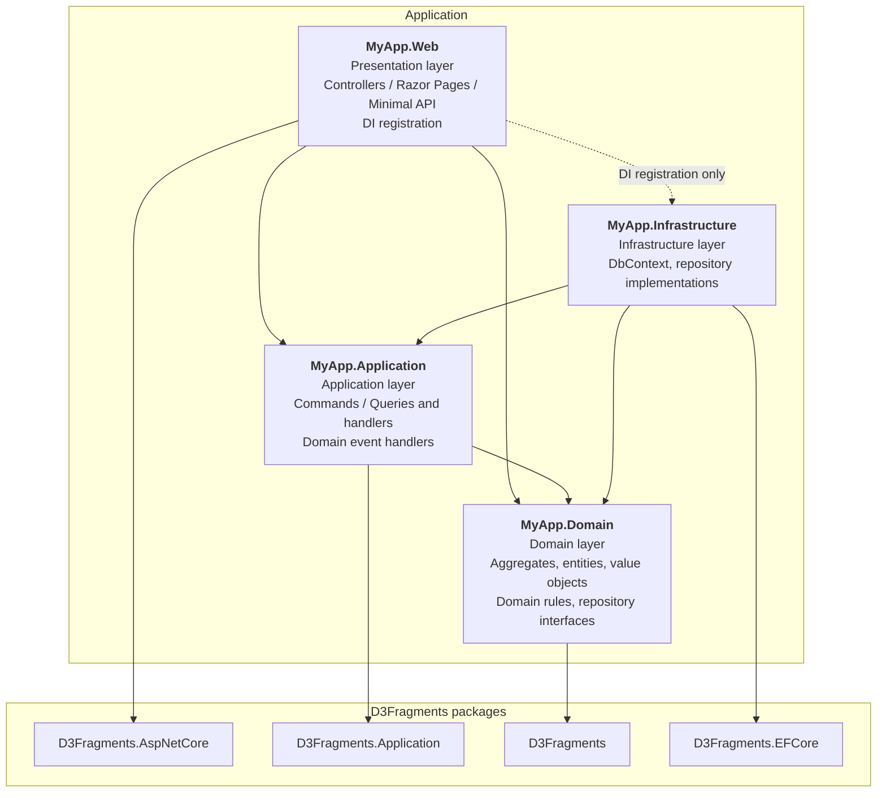
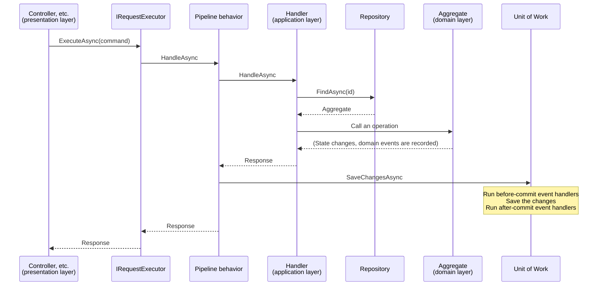

# Architecture

D3Fragments assumes an architecture based on Clean Architecture.
This page describes the layers that make up an application and the rules for dependencies between them.

## Overview

A typical application that uses D3Fragments consists of the following four projects.
The arrows represent project references (the direction of dependency).



The domain layer does not depend on any other layer.
Repository interfaces are defined in the domain layer and implemented in the infrastructure layer.
As a result, the code in the domain and application layers does not depend on EF Core.
You can change how the database is accessed without rewriting these layers.

The presentation layer references the infrastructure layer only to register services in the DI container.
Controllers and similar classes never use repository implementations or the `DbContext` directly.

## How a request is processed

The presentation layer executes Commands and Queries through `IRequestExecutor<TRequest, TResponse>`.
Pipeline behaviors run before and after the handler, and for a Command they save the changes after the handler completes successfully.



If the handler throws a `DomainException`, the changes are discarded without being saved.
The exception propagates to the caller as is, and if you use the ASP.NET Core integration, it is converted into an error response.
For details, see [Application layer](04-application/index.md) and [ASP.NET Core integration](06-aspnetcore/index.md).

## Architecture layers of assemblies

Each assembly (project) belongs to one of the following four architecture layers.
Declare the layer an assembly belongs to by applying the `ArchitectureLayerAttribute` attribute in `AssemblyInfo.cs`.
`ArchitectureLayerAttribute` is included in the `Sashimi343.D3Fragments` package.

| Architecture layer | Value |
| :--- | :--- |
| Presentation layer (user interface layer) | `ArchitectureLayerType.Presentation` |
| Application layer | `ArchitectureLayerType.Application` |
| Domain layer | `ArchitectureLayerType.Domain` |
| Infrastructure layer | `ArchitectureLayerType.Infrastructure` |

If one assembly implements multiple layers, join the `ArchitectureLayerType` values with `|`.

```csharp
using D3Fragments;

[assembly: ArchitectureLayer(ArchitectureLayerType.Application | ArchitectureLayerType.Domain)]
```

The analyzers check references between layers based on this attribute.
See [DFR0001](../analyzers/DFR0001.md) for the allowed dependencies.

## Module layers

Module layers subdivide the classes and interfaces in each architecture layer by their roles.
The analyzers check references between classes based on module layers ([DFR0002](../analyzers/DFR0002.md) and others).

### Determining the module layer

The module layer of a class or interface is determined by the combination of the following two:

- The architecture layer of the assembly the class or interface belongs to
- The types the class or interface inherits or implements

The following rules apply:

- Classes and interfaces in an assembly without `ArchitectureLayerAttribute` have no module layer. They are not checked by the rules that are based on module layers either.
- For example, a class that inherits `EntityBase<TId>` is determined as `Domain_Entity` only when it is in a domain layer assembly.
- In an assembly with multiple architecture layers, a class or interface is determined as a module layer if it meets the conditions of that module layer in any of those layers. For example, a class derived from `EntityBase<TId>` in an assembly with the application and domain layers is `Domain_Entity`.
- In an assembly with multiple architecture layers, a class or interface that does not meet the conditions of any module layer is determined as `Other` (other, with an unknown architecture layer), because it cannot be determined which layer's `*_Other` it belongs to. In an assembly with a single architecture layer, it is determined as that layer's `*_Other`.
- If a class or interface meets the conditions of multiple module layers, it is determined as the first matching module layer in the order listed on this page.

### Presentation layer (user interface layer)

#### Presentation_Controller

A class that directly or indirectly inherits ASP.NET Core's [PageBase](https://learn.microsoft.com/dotnet/api/microsoft.aspnetcore.mvc.razorpages.pagebase), [PageModel](https://learn.microsoft.com/dotnet/api/microsoft.aspnetcore.mvc.razorpages.pagemodel), or [ControllerBase](https://learn.microsoft.com/dotnet/api/microsoft.aspnetcore.mvc.controllerbase), or that implements the [IComponent](https://learn.microsoft.com/dotnet/api/microsoft.aspnetcore.components.icomponent) interface.

#### Presentation_Other

A class or interface in the presentation layer that does not fall under any of the above.

### Application layer

#### Application_Request

A class that directly or indirectly implements the `D3Fragments.Application.IRequest<TResponse>` interface or the `D3Fragments.Application.ICommand` interface.

#### Application_RequestHandler

A class that directly or indirectly implements the `D3Fragments.Application.IRequestHandler<in TRequest, TResponse>` interface.

#### Application_RequestExecutor

A class that directly or indirectly implements the `D3Fragments.Application.IRequestExecutor<in TRequest, TResponse>` interface.

#### Application_DomainEventHandler

A class that directly or indirectly implements the `D3Fragments.Application.IBeforeCommitDomainEventHandler<in TEvent>` or `D3Fragments.Application.IAfterCommitDomainEventHandler<in TEvent>` interface.

#### Application_PipelineBehavior

A class that directly or indirectly implements the `D3Fragments.Application.IPipelineBehavior<in TRequest, TResponse>` interface.

#### Application_Other

A class or interface in the application layer that does not fall under any of the above.

### Domain layer

#### Domain_Entity

A class that directly or indirectly inherits the `D3Fragments.EntityBase<TId>` class.

#### Domain_ValueObject

A class that directly or indirectly implements the `D3Fragments.IValueObject<TSelf, TPrimitive>` interface.

#### Domain_RepositoryInterface

An interface that directly or indirectly inherits the `D3Fragments.IRepository<TAggregate, TId>` interface.

#### Domain_DomainRule

A class that directly or indirectly implements the `D3Fragments.IDomainRule<in TContext>` interface.

#### Domain_Other

A class or interface in the domain layer that does not fall under any of the above.

### Infrastructure layer

#### Infrastructure_RepositoryImplementation

A class that directly or indirectly implements the `D3Fragments.IRepository<TAggregate, TId>` interface.

#### Infrastructure_DbContext

A class that directly or indirectly inherits the `Microsoft.EntityFrameworkCore.DbContext` class.

#### Infrastructure_UnitOfWork

A class that directly or indirectly implements the `D3Fragments.Application.IUnitOfWork` interface.

#### Infrastructure_Other

A class or interface in the infrastructure layer that does not fall under any of the above.
