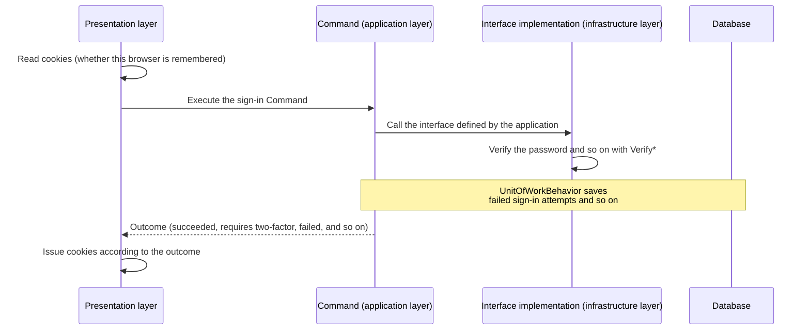

# ASP.NET Core Identity integration

The building blocks for using ASP.NET Core Identity in line with the D3Fragments architecture are provided by the `Sashimi343.D3Fragments.Identity.EFCore` package and part of the `Sashimi343.D3Fragments.AspNetCore` package.

## Why the building blocks are needed

Used as is, ASP.NET Core Identity does not fit two assumptions of D3Fragments.

- **The Unit of Work saves changes.** The EF Core stores of Identity (`AddEntityFrameworkStores`) call `SaveChanges` on every `UserManager<TUser>` operation. Because of this, creating a user and registering business data cannot be saved together in one Command.
- **Database writes happen in a Command, and cookie operations happen in the presentation layer.** Methods such as `SignInManager<TUser>.PasswordSignInAsync` both record failed sign-in attempts (database) and issue cookies in a single call.

D3Fragments provides building blocks that resolve these two mismatches.
Which authentication methods to use (password, two-factor authentication, passkeys, external login, and so on) is up to the application.

| Building block | Package | Layer | Contents |
|---|---|---|---|
| `AddD3FragmentsStores` | `Sashimi343.D3Fragments.Identity.EFCore` | Infrastructure layer | Registers user and role stores that leave saving to the Unit of Work |
| `Verify*` extension methods | `Sashimi343.D3Fragments.Identity.EFCore` | Infrastructure layer | Perform only the database side of the `SignInManager<TUser>` sign-in methods |
| `ToResult` extension methods | `Sashimi343.D3Fragments.Identity.EFCore` | Infrastructure layer | Convert an `IdentityResult` into a `Result` |
| Cookie-side extension methods | `Sashimi343.D3Fragments.AspNetCore` (namespace `D3Fragments.AspNetCore.Identity`) | Presentation layer | Perform only the cookie side of the `SignInManager<TUser>` sign-in methods |
| [DFR0017](../../analyzers/DFR0017.md) | `Sashimi343.D3Fragments.Analyzers` | All | Warns about calls to methods that write to the database and operate on cookies at the same time |

| Page | Contents |
|---|---|
| [Setup](01-setup.md) | `DbContext`, the user type and the business user, service registration, converting `IdentityResult` |
| [Sign-in and sign-out](02-sign-in.md) | Password, two-factor authentication, recovery codes, passkeys, external login, sign-out |
| [Notes](03-notes.md) | Security stamps and re-issuing cookies, differences caused by leaving saving to the Unit of Work, Identity behavior |

## Division of work between layers

Sign-in is divided between the layers as follows.

The application layer does not depend on Identity.
The application defines interfaces such as sign-in verification, and the infrastructure layer implements them with Identity.

## Demo application

The code examples in this guide are taken from the [demo application](https://github.com/sashimi343/D3Fragments/tree/main/demo/02_IdentityIntegration) (Razor Pages).
The demo implements user registration, password sign-in, two-factor authentication (authenticator app and email), recovery codes, passkeys, and external login (Keycloak).
