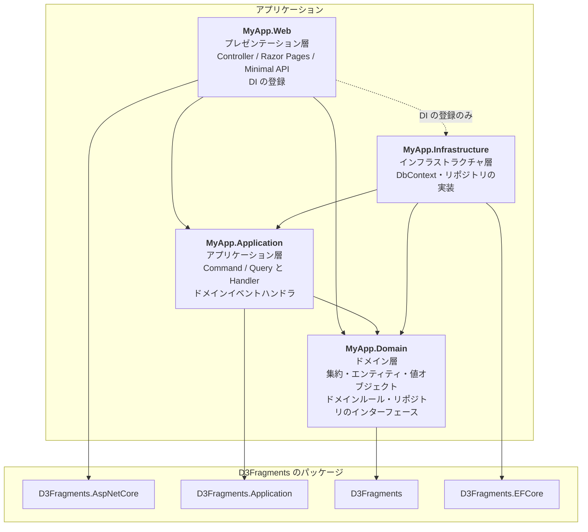
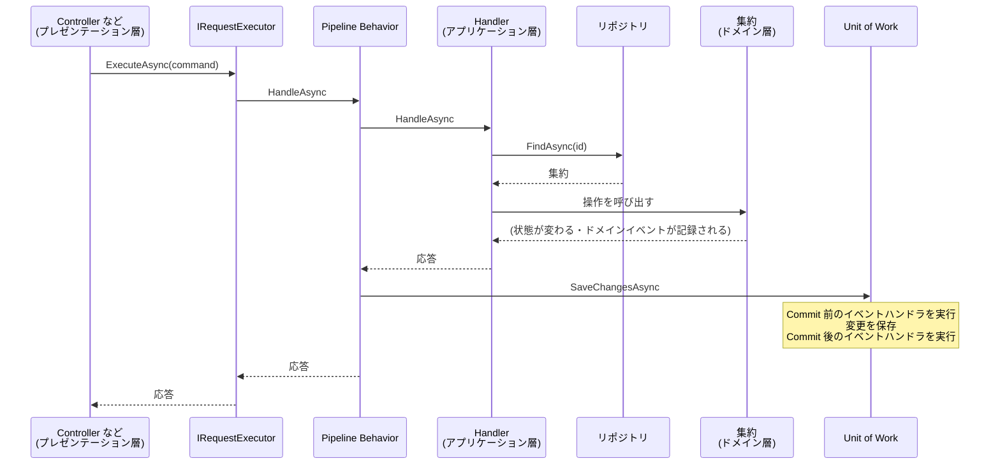

# アーキテクチャ

D3Fragments は Clean Architecture をもとにしたアーキテクチャを前提にしています。
このページではアプリケーションを構成する層と、層の間の依存関係のルールを説明します。

## 全体像

D3Fragments を使う標準的なアプリケーションは、次の4つのプロジェクトで構成します。
矢印はプロジェクト参照（依存の向き）を表します。



ドメイン層はほかの層に依存しません。
リポジトリはドメイン層でインターフェースを定義し、インフラストラクチャ層で実装します。
そのため、ドメイン層とアプリケーション層のコードは EF Core に依存しません。
DB へのアクセス方法を変えても、これらの層を書き換えずに済みます。

プレゼンテーション層からインフラストラクチャ層への参照は、DI コンテナへの登録のためだけに使います。
Controller などから、リポジトリの実装や `DbContext` を直接使うことはありません。

## リクエストの処理の流れ

プレゼンテーション層は `IRequestExecutor<TRequest, TResponse>` を通して Command / Query を実行します。
Handler の前後では Pipeline Behavior が動き、Command の場合は Handler が正常に終わった後に変更を保存します。



Handler が `DomainException` をスローした場合、変更は保存されずに破棄されます。
例外はそのまま呼び出し元に伝わり、ASP.NET Core 連携を使っていればエラー応答に変換されます。
詳しくは [アプリケーション層](04-application/index.md) と [ASP.NET Core 連携](06-aspnetcore/index.md) を参照してください。

## アセンブリのアーキテクチャ層

アセンブリ（プロジェクト）は次の4つのアーキテクチャ層のいずれかに属します。
アセンブリが属する層は、`AssemblyInfo.cs` に `ArchitectureLayerAttribute` 属性を付けて明示します。
`ArchitectureLayerAttribute` は `Sashimi343.D3Fragments` パッケージに含まれています。

| アーキテクチャ層 | 設定値 |
| :--- | :--- |
| プレゼンテーション層（ユーザインターフェース層） | `ArchitectureLayerType.Presentation` |
| アプリケーション層 | `ArchitectureLayerType.Application` |
| ドメイン層 | `ArchitectureLayerType.Domain` |
| インフラストラクチャ層 | `ArchitectureLayerType.Infrastructure` |

1つのアセンブリが複数の層を実装している場合は、`ArchitectureLayerType` を `|` でつないで指定します。

```csharp
using D3Fragments;

[assembly: ArchitectureLayer(ArchitectureLayerType.Application | ArchitectureLayerType.Domain)]
```

アナライザはこの属性をもとに層の間の参照を検査します。
許可される依存関係は [DFR0001](../analyzers/DFR0001.md) を参照してください。

## モジュールレイヤー

モジュールレイヤーは、各アーキテクチャ層の中のクラスとインターフェースを役割ごとに細かく分けたものです。
アナライザはモジュールレイヤーをもとにクラス間の参照を検査します（[DFR0002](../analyzers/DFR0002.md) など）。

### モジュールレイヤーの判定

クラス・インターフェースのモジュールレイヤーは、次の2つの組み合わせで決まります。

- そのクラス・インターフェースが属するアセンブリのアーキテクチャ層
- そのクラス・インターフェースが継承・実装している型

判定には次のルールがあります。

- `ArchitectureLayerAttribute` が設定されていないアセンブリのクラス・インターフェースは、モジュールレイヤーを持ちません。モジュールレイヤーにもとづく規則でも検査されません。
- たとえば `EntityBase<TId>` を継承したクラスが `Domain_Entity` と判定されるのは、ドメイン層のアセンブリにある場合だけです。
- 複数のアーキテクチャ層を持つアセンブリでは、それらの層のどれかのモジュールレイヤーの条件に当てはまれば、そのモジュールレイヤーと判定します。たとえば、アプリケーション層とドメイン層を持つアセンブリにある `EntityBase<TId>` の派生クラスは `Domain_Entity` です。
- 複数のアーキテクチャ層を持つアセンブリで、どのモジュールレイヤーの条件にも当てはまらないクラス・インターフェースは `Other`（アーキテクチャ層が不明なその他）と判定します。どの層の `*_Other` かを決められないためです。アーキテクチャ層が1つだけのアセンブリでは、その層の `*_Other` と判定します。
- 複数のモジュールレイヤーの条件に当てはまる場合は、このページでの記載順で最初に当てはまったモジュールレイヤーと判定します。

### プレゼンテーション層（ユーザインターフェース層）

#### Presentation_Controller

ASP.NET Core の [PageBase](https://learn.microsoft.com/dotnet/api/microsoft.aspnetcore.mvc.razorpages.pagebase)、[PageModel](https://learn.microsoft.com/dotnet/api/microsoft.aspnetcore.mvc.razorpages.pagemodel)、[ControllerBase](https://learn.microsoft.com/dotnet/api/microsoft.aspnetcore.mvc.controllerbase) を直接または間接的に継承したクラス、または [IComponent](https://learn.microsoft.com/dotnet/api/microsoft.aspnetcore.components.icomponent) インターフェースを実装したクラスです。

#### Presentation_Other

プレゼンテーション層のクラス・インターフェースのうち、上記のどれにも当てはまらないものです。

### アプリケーション層

#### Application_Request

`D3Fragments.Application.IRequest<TResponse>` インターフェース、または `D3Fragments.Application.ICommand` インターフェースを直接または間接的に実装したクラスです。

#### Application_RequestHandler

`D3Fragments.Application.IRequestHandler<in TRequest, TResponse>` インターフェースを直接または間接的に実装したクラスです。

#### Application_RequestExecutor

`D3Fragments.Application.IRequestExecutor<in TRequest, TResponse>` インターフェースを直接または間接的に実装したクラスです。

#### Application_DomainEventHandler

`D3Fragments.Application.IBeforeCommitDomainEventHandler<in TEvent>` または `D3Fragments.Application.IAfterCommitDomainEventHandler<in TEvent>` インターフェースを直接または間接的に実装したクラスです。

#### Application_PipelineBehavior

`D3Fragments.Application.IPipelineBehavior<in TRequest, TResponse>` インターフェースを直接または間接的に実装したクラスです。

#### Application_Other

アプリケーション層のクラス・インターフェースのうち、上記のどれにも当てはまらないものです。

### ドメイン層

#### Domain_Entity

`D3Fragments.EntityBase<TId>` クラスを直接または間接的に継承したクラスです。

#### Domain_ValueObject

`D3Fragments.IValueObject<TSelf, TPrimitive>` インターフェースを直接または間接的に実装したクラスです。

#### Domain_RepositoryInterface

`D3Fragments.IRepository<TAggregate, TId>` インターフェースを直接または間接的に継承したインターフェースです。

#### Domain_DomainRule

`D3Fragments.IDomainRule<in TContext>` インターフェースを直接または間接的に実装したクラスです。

#### Domain_Other

ドメイン層のクラス・インターフェースのうち、上記のどれにも当てはまらないものです。

### インフラストラクチャ層

#### Infrastructure_RepositoryImplementation

`D3Fragments.IRepository<TAggregate, TId>` インターフェースを直接または間接的に実装したクラスです。

#### Infrastructure_DbContext

`Microsoft.EntityFrameworkCore.DbContext` クラスを直接または間接的に継承したクラスです。

#### Infrastructure_UnitOfWork

`D3Fragments.Application.IUnitOfWork` インターフェースを直接または間接的に実装したクラスです。

#### Infrastructure_Other

インフラストラクチャ層のクラス・インターフェースのうち、上記のどれにも当てはまらないものです。
