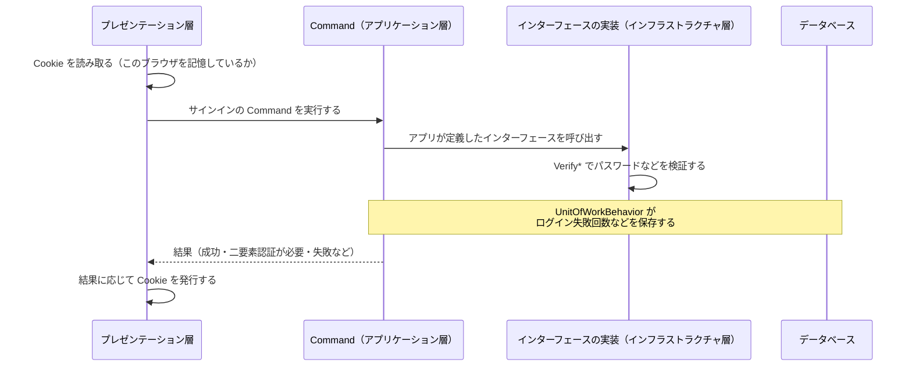

# ASP.NET Core Identity 連携

ASP.NET Core Identity を D3Fragments のアーキテクチャに合わせて使うための部品は、`Sashimi343.D3Fragments.Identity.EFCore` パッケージと、`Sashimi343.D3Fragments.AspNetCore` パッケージの一部が提供します。

## なぜ部品が必要か

ASP.NET Core Identity をそのまま使うと、D3Fragments の2つの前提と合いません。

- **保存は Unit of Work が行う。** Identity の EF Core 用のストア（`AddEntityFrameworkStores`）は、`UserManager<TUser>` の操作ごとに `SaveChanges` を呼びます。そのため、ユーザーの作成と業務データの登録を1つの Command でまとめて保存できません。
- **データベースへの書き込みは Command で、Cookie の操作はプレゼンテーション層で行う。** `SignInManager<TUser>` の `PasswordSignInAsync` などは、1回の呼び出しでログイン失敗回数の記録（データベース）と Cookie の発行の両方を行います。

D3Fragments はこの2つの食い違いを解消する部品を提供します。
どの認証方法（パスワード、二要素認証、パスキー、外部ログインなど）を使うかは、アプリケーションが決めます。

| 部品 | パッケージ | 使う層 | 内容 |
|---|---|---|---|
| `AddD3FragmentsStores` | `Sashimi343.D3Fragments.Identity.EFCore` | インフラストラクチャ層 | 保存を Unit of Work に任せるユーザーストア・ロールストアを登録する |
| `Verify*` 拡張メソッド | `Sashimi343.D3Fragments.Identity.EFCore` | インフラストラクチャ層 | `SignInManager<TUser>` のサインインのうち、データベース側の処理だけを行う |
| `ToResult` 拡張メソッド | `Sashimi343.D3Fragments.Identity.EFCore` | インフラストラクチャ層 | `IdentityResult` を `Result` に変換する |
| Cookie 側の拡張メソッド | `Sashimi343.D3Fragments.AspNetCore`（名前空間 `D3Fragments.AspNetCore.Identity`） | プレゼンテーション層 | `SignInManager<TUser>` のサインインのうち、Cookie 側の処理だけを行う |
| [DFR0017](../../analyzers/DFR0017.md) | `Sashimi343.D3Fragments.Analyzers` | すべて | データベースへの書き込みと Cookie の操作を同時に行うメソッドの呼び出しを警告する |

| ページ | 内容 |
|---|---|
| [構成](01-setup.md) | `DbContext`、ユーザーの型と業務上の利用者、サービスの登録、`IdentityResult` の変換 |
| [ログインとログアウト](02-sign-in.md) | パスワード、二要素認証、回復コード、パスキー、外部ログイン、ログアウト |
| [注意点](03-notes.md) | security stamp と Cookie の作り直し、保存を Unit of Work に任せることによる違い、Identity の仕様 |

## 層の分担

ログインの処理は次のように分担します。

アプリケーション層は Identity に依存しません。
サインインの検証などのインターフェースはアプリケーションが定義し、インフラストラクチャ層で Identity を使って実装します。

## デモアプリケーション

このガイドのコード例は、[デモアプリケーション](https://github.com/sashimi343/D3Fragments/tree/main/demo/02_IdentityIntegration)（Razor Pages）から取っています。
デモでは、ユーザー登録、パスワードでのログイン、二要素認証（認証アプリ・メール）、回復コード、パスキー、外部ログイン（Keycloak）を実装しています。
